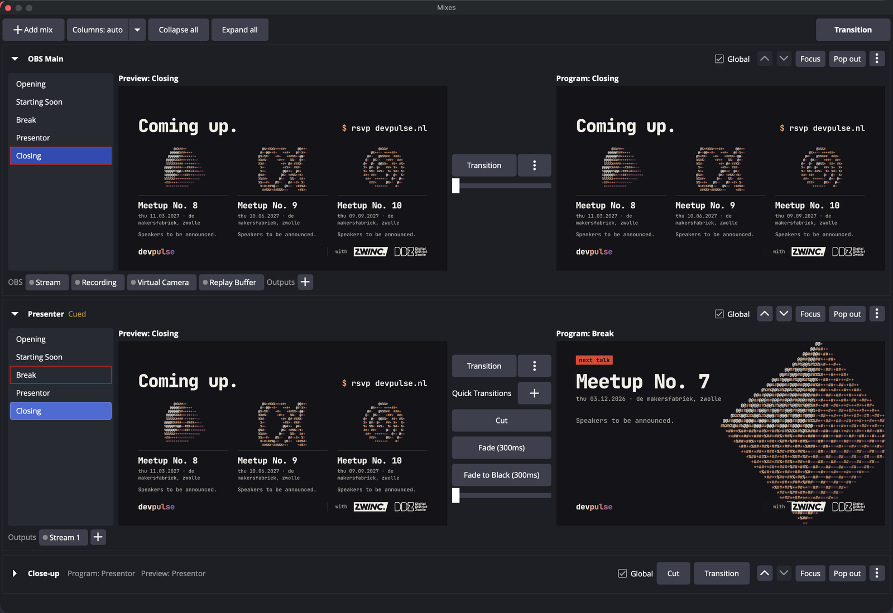

# Dual Mixer

Run any number of independent video mixes inside one OBS Studio instance. Each mix has its own Preview, Program, scene selection and transitions, laid out like OBS Studio Mode. Mixes can switch together or on their own.



## Features

- **Independent mixes:** add, rename, reorder and remove as many mixes as you need. Every mix uses your existing OBS scenes, either all of them or a chosen subset.
- **Studio Mode per mix:** each row has a scene list, Preview, Program, a Transition button, Quick Transitions (Cut, Fade, Fade to Black and others) and a T-bar.
- **OBS transitions:** each mix follows the transition selected in OBS (the global transition) or overrides it with another one. Every mix plays its own copy, so stingers run on several mixes at once.
- **Global Transition:** cue new Previews on the mixes you want to change, then press **Transition** (top right). Only mixes marked *Global* with a new cue switch. The others keep their Program.
- **Outputs per mix:** send a mix's Program to a projector (fullscreen on a display, or windowed), a recording, a stream, or a Blackmagic Design device (DeckLink, UltraStudio, Intensity). A mix can feed several outputs at once.
- **Native OBS stays native:** OBS Main appears as a mix. Its Stream, Recording, Virtual Camera and Replay Buffer keep their OBS settings, hotkeys and obs-websocket control.
- **Workspace:** collapse rows, focus one mix, or pop a mix out into its own dock.
- **Hotkeys** for every mix: Transition, Cut, next/previous Preview, each quick transition, plus one global "Transition all cued mixes".

## Good to know

- **Native outputs always carry OBS Main.** OBS attaches its own streaming and recording to the main canvas, so to send another mix to a stream or file, add an output to that mix.
- **Mixes are video only.** Recordings, streams and Blackmagic devices take audio from OBS's mixer tracks, chosen per output. A mix can optionally add its Program audio to OBS's audio output.
- **Blackmagic devices use OBS's DeckLink output.** They need Blackmagic Desktop Video installed. Only modes matching OBS's frame rate are offered, and the mix is scaled to the mode's resolution. A device feeds one output at a time, so don't point OBS's own **Tools → DeckLink Output** at the same device.
- **Video settings lock while plugin outputs run.** Stop plugin recordings, streams and devices before changing OBS's video settings; OBS refuses video changes while any output is active.
- **Settings are saved per scene collection,** including stream keys of plugin streams.

## Requirements

OBS Studio 31.1 or newer. Built and tested on macOS with OBS 32.2.

## Install

Build the plugin (below) and copy `dual-mixer.plugin` into `~/Library/Application Support/obs-studio/plugins/`. Restart OBS and enable **Docks → Mixes**.

## Build

Uses the [OBS plugin template](https://github.com/obsproject/obs-plugintemplate). OBS sources and dependencies are downloaded automatically.

```sh
cmake --preset macos
cmake --build build_macos --config RelWithDebInfo
```

Formatting uses clang-format 19.1.1 and gersemi:

```sh
pipx install clang-format==19.1.1 && pipx install gersemi
build-aux/run-clang-format && build-aux/run-gersemi
```

Windows and Ubuntu presets come from the template but have not been built yet.

## License

GPL-2.0, see [LICENSE](LICENSE).
